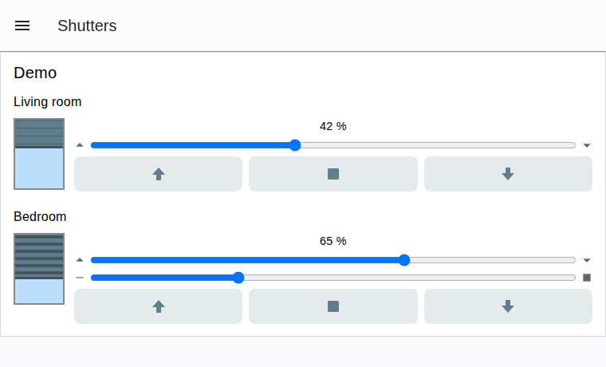
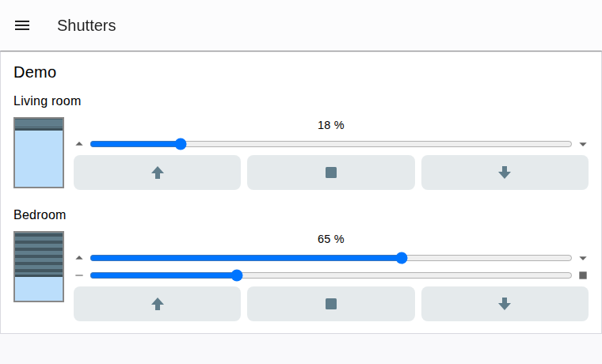

# @seaspotter/node-red-dashboard-2-ui-shutter

A single third-party [Node-RED Dashboard 2.0](https://dashboard.flowfuse.com/) widget for controlling a
shutter or venetian blind: up/stop/down buttons, a position slider, an optional slat slider, and an
animated window graphic - all in one node, wiring straight into KNX (or any other) nodes without
template/function/switch nodes in between.

Built against the Dashboard 2.0 [third-party widget guide](https://dashboard.flowfuse.com/contributing/widgets/third-party.html):
like every external widget, it extends the core `ui-template` node and ships its own HTML/CSS/JS bundle
(see [Development](#development)).

## Install

Via the Node-RED editor's Palette Manager (menu -> Manage palette -> Install), search for
`@seaspotter/node-red-dashboard-2-ui-shutter`.

Or from the command line, from your Node-RED user directory (usually `~/.node-red`):

```
npm install @seaspotter/node-red-dashboard-2-ui-shutter
```

then restart Node-RED. Requires Node-RED >= 3 and `@flowfuse/node-red-dashboard` >= 1.30.

To install from a local clone instead (e.g. to try an unreleased change), use
`npm install /path/to/node-red-dashboard-2-ui-shutter` in place of the registry install above.

## Node configuration

| Field | Default | Notes |
|---|---|---|
| `name` | "" | Node name shown in the flow editor |
| `group` / `order` / `width` / `height` | - | Standard Dashboard placement fields |
| `label` | "" | Shown above the controls |
| `shutterType` | `shutter` | `shutter` or `blind`. `blind` adds the slat slider and output 4 |
| `zeroMeans` | `open` | `open` (KNX default: 0 % = open, 100 % = closed) or `closed` (inverted). Only affects the graphic and open/closed texts - values on inputs/outputs are never converted |
| `showGraphic` | `true` | Show the animated window graphic |
| `showButtons` | `true` | Show the up/stop/down buttons |
| `showSlider` | `true` | Show the position (and slat) slider(s) |
| `showPositionText` | `true` | Show "73 %" / "Open" / "Closed" text |
| `textOpen` / `textClosed` | "Open" / "Closed" | Fully editable, e.g. for German "Offen" / "Geschlossen" |
| `color` | `#607d8b` | Cover/slat color |
| `skyColor` | `#bbdefb` | Window background color |
| `positionProperty` | `payload` | Input `msg` property read for the position (0-100) |
| `slatProperty` | `slats` | Input `msg` property read for the slat angle (0-100, blind only) |
| `upValue` / `downValue` | `false` / `true` (bool) | Typed (str/num/bool/json). KNX DPT 1.008: 0 = up, 1 = down |
| `stopValue` | `true` (bool) | Typed (str/num/bool/json) |
| `topic` | "" | Optional topic applied to all output messages |

## Messages

### Input (one input)

Send a position and/or slat angle (0-100) as separate messages or combined in one:

```js
msg.payload = 42   // position, matches default positionProperty
msg.slats = 70      // slat angle, matches default slatProperty (blind only)
```

Status telegrams usually arrive separately (e.g. from a KNX status group address) - the node merges
whatever it receives into its own stored state `{ position, slats }`. Out-of-range numbers are clamped
to 0-100; non-numeric values are ignored with a node warning. The node does **not** pass input messages
through - its outputs only ever carry commands (see below).

### Outputs

| # | Meaning | Payload | Extra props | Shutter | Blind |
|---|---|---|---|:---:|:---:|
| 1 | Move up/down | `upValue` or `downValue` | `msg.action = 'up' \| 'down'` | X | X |
| 2 | Stop | `stopValue` | `msg.action = 'stop'` | X | X |
| 3 | Set position | number 0-100 | `msg.action = 'position'` | X | X |
| 4 | Set slats | number 0-100 | `msg.action = 'slats'` | | X |

`msg.topic` is set on every output when `topic` is configured. Each user action (button press, or slider
release) emits exactly one message, on exactly one output.

## Example wiring (knxUltimate)

```
[ui-shutter] output 1 (up/down) --> knxUltimate "Auf/Ab"        (DPT 1.008)
[ui-shutter] output 2 (stop)    --> knxUltimate "Stop"
[ui-shutter] output 3 (position)--> knxUltimate "Position"      (DPT 5.001)
knxUltimate "Position status"   --> [ui-shutter] input
```

For blinds, wire a second status group address (slat position) through a change node setting
`msg.slats` before it reaches the widget's input, since Dashboard widgets only have one input.

## Development

```
npm install
npm run build        # one-off Vite build to resources/
npm run dev          # rebuild on change
```

The built UMD/ESM bundles in `resources/` are committed to the repo so the package works for consumers
without a build step after install.

## Example

[examples/example-flow.json](examples/example-flow.json) is a self-contained flow - a shutter and a blind,
each wired to inject/function nodes that fake a KNX round-trip (command in, status echoed back a second
later) so you can see the widget move without any real hardware. Import it via the editor's
*Import* dialog (hamburger menu -> Import, or `Ctrl+I`), deploy, and open the dashboard.

## Screenshots





## Release process

Releases are handled by [Release Please](https://github.com/googleapis/release-please) based on
[Conventional Commits](https://www.conventionalcommits.org/en/v1.0.0/) PR titles:

1. **`Prepare release`** workflow runs on every push to `main`. It reads commit history since the last
   release, maintains a standing "release PR" with the version bump and changelog, and keeps it up to
   date as more PRs land.
2. Merging that release PR creates the `vX.Y.Z` tag and the GitHub Release, which (in the same workflow
   run, as a follow-up job gated on release-please's `release_created` output) builds the package,
   publishes it to the public npm registry, then triggers a refresh on the
   [Node-RED Flow Library](https://flows.nodered.org/) catalogue entry. This runs as a job in the same
   workflow rather than a separate tag-triggered one, because a tag created via the default
   `GITHUB_TOKEN` doesn't trigger other workflows.
3. **`Lint Pull Request Title`** enforces the `<type>(<scope>): <subject>` format on every PR (`feat:` ->
   minor, `fix:`/`perf:` -> patch, `feat!:`/`fix!:` -> major, `docs:`/`chore:`/`refactor:` -> no release
   unless paired with a breaking change).

`Publish Release` still exists as a manual (`workflow_dispatch`-only) rescue workflow, in case the
automated publish job ever needs to be re-run by hand.

`main` is protected: every change, including the release PR, goes through a pull request with a passing
build.
